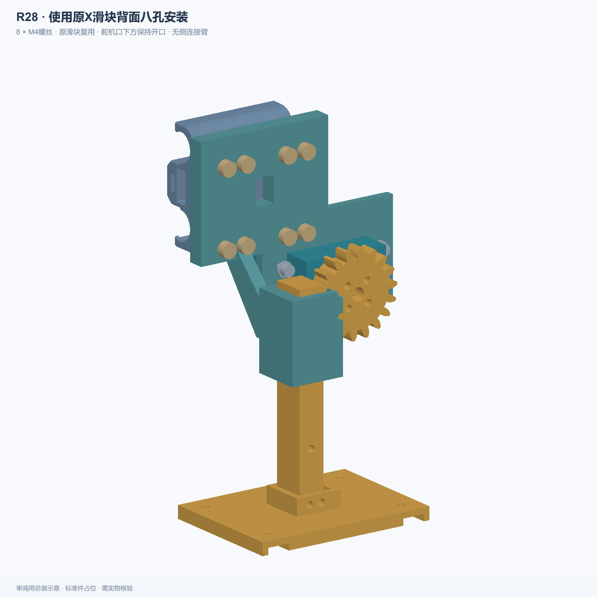
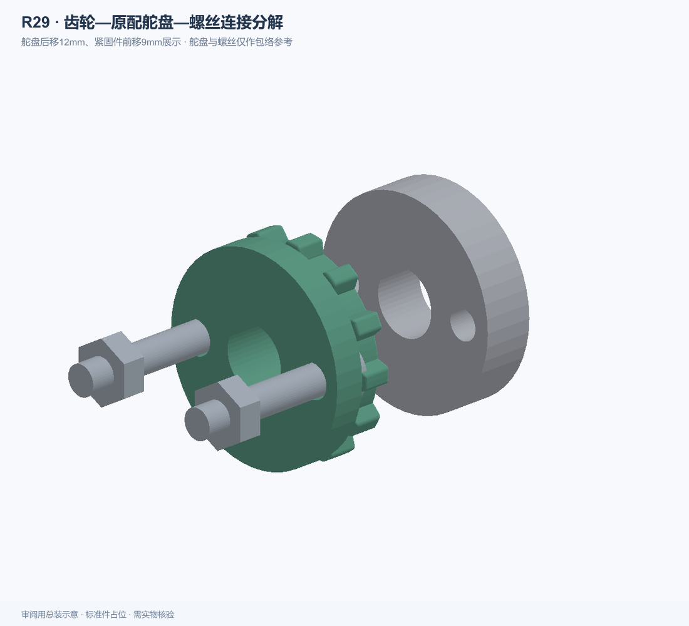

# 大鱼写字机升降机械爪工程

更新日期：2026-11-02。最新状态为 **R28 升降八孔安装 + R29 原配舵盘连接夹爪试装版**。仓库内 2026-10-30 的预览和旧快照保留作为历史资料，以本说明为当前入口。

## 当前下载与替换关系

1. [R23 基础结构打印包](机械爪_R23_装配孔与打印STL.zip)：基础零件和装配资料。
2. [R28 八孔背面安装包](升降_R28_原八孔背面安装.zip)：用 P01_R28 替换旧导向座，复用原 X 滑块背面八孔，不再补通中间两孔。8 颗 M4×16，原滑块已有则复用。
3. [R29 舵盘连接试装包](夹爪_R29_原配舵盘试装件.zip)：成套替换 P27 输入齿轮与 P13 夹爪背板，其余件沿用。

以上三个包配合使用。R22、R25、R26、R27及更早版本不作为本次新增打印清单。完整快照保留这些历史版本和未通过的试验记录，不能据文件编号直接认定可打印。

## 最新结构

- 整套升降导向座位于 X 滑块背面；取消外围框架、长侧板和两侧连接臂，保留短齿条导向及薄斜筋。
- 原滑块八孔 Ø4.4，四列横向间距 9.5 / 21 / 9.5 mm，两排间距 35.3 mm。
- 齿条底部平台通过四个短角码连接夹爪，每个角码两颗螺丝。
- 圆爪凸弧面朝外，使用已更新高度与顶部插接接口的版本。
- 升降为 TBS-K20，夹爪为 S20F，用户确认均为 180°。当前升降理论工作行程 47.12 mm，不代表实物承载行程。



## S20F 原配舵盘接口与试装限制

夹爪输入齿轮通过螺丝固定到 S20F 原配舵盘，保留原配舵盘的花键及中心锁紧螺丝，不使用升降用光孔法兰替代。

按用户提供尺寸建模：舵盘外径 20 mm、相对两孔中心距 14 mm、孔径 3 mm、厚度 5 mm。齿轮连接孔 Ø3.4，正面增加 3 mm 承托盘，总厚 6.125 mm；配套 P13 增加 Ø23 避让窗口。

R29 是试装件。现有轴向布局要求舵盘贴齿轮的平面高出舵机壳体 7.05 mm，这个安装后高度尚未实测；不能仅凭舵盘厚度认为已吻合。按 Ø5.7×1.65 螺丝头包络，头部距壳体仅 0.4 mm，需核对实际头型。紧固件、试装顺序及限制见包内说明。



模型已做闭合实体、孔位及规定位置的几何检查，未进行实物承载或完整舵机驱动全行程验证。没有生成 G-code 或启动打印。

## 完整资料、源码与历史恢复

`project_snapshot_20261102.zip.001` 至 `.007` 是同一个完整 ZIP 的二进制分卷，包含 1831 个工程文件：源代码、参考 CAD、STL、预览、检查报告和历史版本。每卷 20 MiB 或更小，不能只改扩展名使用。

下载仓库全部内容后，在文件所在目录运行（Python 3.9 以上，无额外依赖）：

```sh
python restore_20261102.py
```

恢复到 `restored_20261102/project/`，自动逐个核对 SHA-256。只校验而不解压可运行：

```sh
python restore_20261102.py --verify-only
```

恢复后执行 `npm install` 安装 `manifold-3d` 和 `sharp`。最新入口：

- `source/build_r28_eight_hole.mjs`、`source/export_eight_hole_r28.mjs`、`source/audit_eight_hole_r28.mjs`。
- `source/build_s20f_horn_r29.mjs`、`source/s20f_horn_r29.mjs`。

`npm run build` 仍指向早期生成器，不能用来重建最新方案。本快照不含 node_modules、临时锁文件或运行日志；原始工程未被删除。参考模型沿用其原有来源及许可条件。
